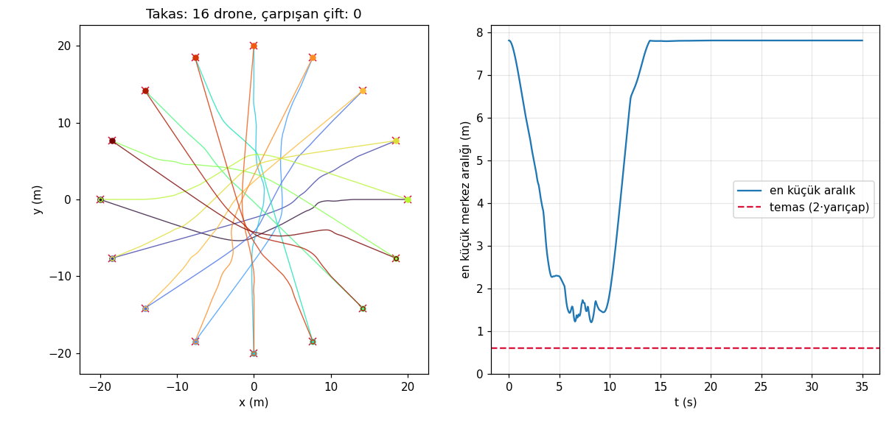
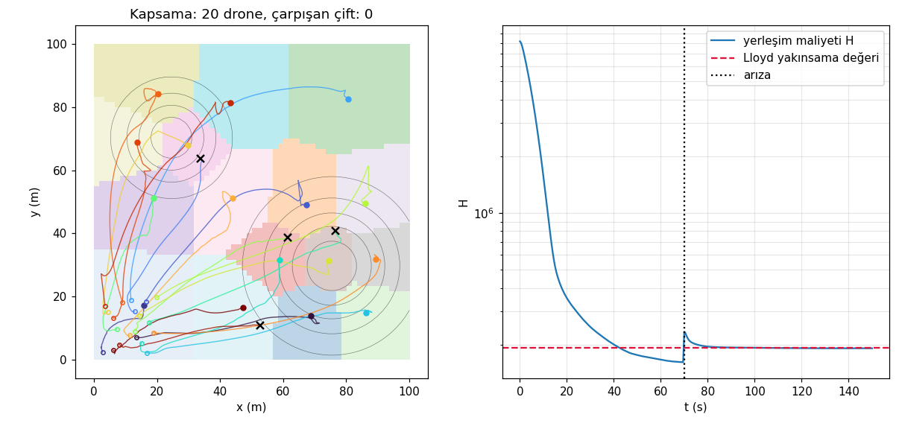
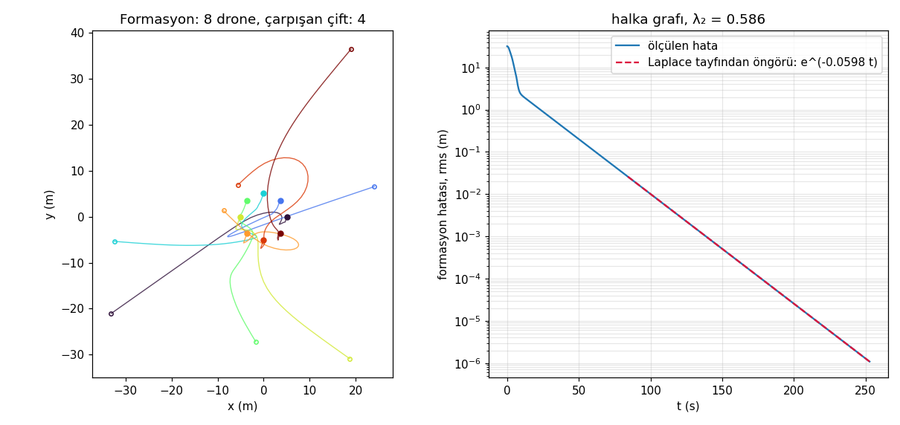

# drone-swarm-simulator

A 2D simulator for swarms of point-mass drones, written to be *checked*: every component is
compared with an analytic result or an independent method, and the checks are part of the
program (`dronesuru dogrulama`) and of the test suite. It is the MVP of roadmap item #93
("2D simulation + visualisation; no real hardware"). CLI messages are in Turkish
(`dronesuru` subcommands are ASCII-transliterated Turkish, like the other tools in this series);
code and this document are in English.



| | |
|---|---|
| **flocking** (Reynolds) | separation, alignment, cohesion, goal and obstacle repulsion |
| **formation control** | graph-consensus with a pinned leader; the decay rate is predicted from the Laplacian spectrum |
| **collision avoidance** | sampled velocity obstacles with an exact time to collision |
| **task allocation** | Bertsekas' auction algorithm, greedy and exact solvers |
| **area coverage** | Lloyd's algorithm on a grid, with drone failures |
| **Vicsek model** | order parameter against noise |

It is a simulator, not a flight controller: no hardware, no rotor or attitude dynamics, no
sensors. See *Scope and limitations*.

## What is real and what is assumed

| | status |
|---|---|
| the algorithms (graph consensus, Lloyd, auction, velocity obstacles, Vicsek, Reynolds rules) | published methods, implemented from their definitions (references below) |
| the drone model: speed limit 8 m/s, acceleration limit 6 m/s², velocity-loop time constant 0.5 s, drag 0.1 /s, radius 0.3 m | **assumed**, illustrative; not any particular airframe |
| communication and sensing | **idealised**: a drone knows the positions and velocities of the drones it reacts to, without noise, delay or loss |
| scenario geometry (arena sizes, obstacle layouts, densities) | invented for the demos |

What the program guarantees is the arithmetic and that each model reproduces an analytic or
independent result (next section). It does not claim that a real swarm would behave this way.

## Models

1. **Dynamics** ([`dynamics.py`](src/drone_suru_simulatoru/dynamics.py)). Each drone obeys
   `dv/dt = a - drag (v - wind)` with the commanded acceleration `a` held constant over a step.
   That linear equation has a closed-form solution, so the step is *exact*: `n` small steps equal
   one large one. Acceleration and speed limits are applied around the exact step. The inner
   velocity loop is `a = (v_des - v)/tau + drag v`; in a steady wind the velocity settles at
   `v_des + tau drag w`.
2. **Graphs** ([`graph.py`](src/drone_suru_simulatoru/graph.py)). Range, k-nearest, ring, path and
   complete communication graphs; Laplacian spectra; connected components by breadth-first search.
3. **Formation control** ([`control.py`](src/drone_suru_simulatoru/control.py)). With
   `e = x - offsets - c(t)` the command is `v_des = v_ref - K (L + B) e`, `B` pinning the leader
   to the moving reference. Through the velocity loop each Laplacian eigenvalue `lam` gives
   `tau s^2 + s + K lam = 0`, so the slowest decay rate of `e` is known before running.
4. **Avoidance** ([`avoidance.py`](src/drone_suru_simulatoru/avoidance.py)). Every drone samples
   candidate velocities (a polar grid plus the preferred and current velocity), computes the time
   to collision with each neighbour and obstacle (a quadratic), and takes the candidate nearest
   its preferred velocity under a soft penalty `weight / time_to_collision`.
5. **Flocking** (`Boids`): acceleration-level Reynolds rules with a goal and circular obstacles.
6. **Task allocation** ([`assign.py`](src/drone_suru_simulatoru/assign.py)). `auction` (epsilon
   scaling, guaranteed within `n eps` of the optimum), `greedy`, `exact` (dynamic programming
   over subsets) and `brute_force`. Surplus drones stay idle.
7. **Coverage** ([`coverage.py`](src/drone_suru_simulatoru/coverage.py)). The locational cost
   `H = integral of density * min_i |q - p_i|^2` on a cell-centred grid; drones fly toward the
   centroid of their cell (Lloyd flow), optionally with avoidance; drones can fail mid-run.
8. **Vicsek model** ([`vicsek.py`](src/drone_suru_simulatoru/vicsek.py)): constant-speed
   particles in a periodic box taking the mean heading of their neighbours plus noise.

## What is checked, and against what

Run `dronesuru dogrulama` to repeat these on your machine (about 30 s; the check details are
printed in English); the tests repeat them with fixed seeds.

- **Integrator.** The closed-form step against RK4 with 4, 8, 16, 32, 64 substeps: the RK4
  error falls 4e-5 → 5e-10 at order 4.04, i.e. RK4 converges *to* the closed form. 40 steps of
  0.05 s equal one step of 2 s to 1e-14.
- **Limits and wind.** Recorded `|a|` and `|v|` never exceed the limits (and reach them). A
  hovering drone in a 3.6 m/s wind drifts at exactly `tau drag w` = (0.15, −0.10) m/s.
- **Graphs.** On 200 random range graphs the number of components found by breadth-first search
  equals the number of zero Laplacian eigenvalues, and `lambda_2 > 0` exactly when connected.
  Ring, path and complete graphs match `2 − 2cos(2π/n)`, `2 − 2cos(π/n)` and `n` to 5e-15.
- **Consensus rate.** The simulated formation error of 8 drones decays at the rate predicted
  by the spectrum: ring 0.05981 measured vs 0.05981 predicted, path 0.02762 vs 0.02762, complete
  graph 0.09447 vs 0.09448 (worst relative difference 1.2e-4). The plain first-order prediction
  `K lambda_min` is off by 1.4-4.7 %, because the velocity loop matters.
- **Wind offset.** A pinned formation in a steady wind is displaced by the solution of
  `K M e = tau drag w`; the simulation agrees with the linear solve to 1.6e-14 m (the largest
  component is 1.97 m, so the effect is real).
- **Time to collision.** The quadratic against brute-force time stepping (1 ms) on 400 random
  pairs (32 colliding within 12 s): largest difference 0.95 ms, no disagreement about whether a
  collision happens.
- **Avoidance.** Antipodal swap on a 20 m circle with `n = 2, 4, 8, 12, 16` drones: 0 colliding
  pairs with avoidance, `1, 6, 28, 66, 120` without it (every pair meets in the middle);
  smallest separation 1.21 m against a contact distance of 0.6 m. Where it stops working is in
  *Findings*.
- **Auction.** On 250 random instances the auction's cost is within `n eps` of the optimum
  (in fact exactly optimal), the subset dynamic program equals brute force over all
  permutations, and no optimal Euclidean matching has two crossing edges (an uncrossing argument
  and a geometric test independent of both solvers). Greedy is on average 2.9 % above the
  optimum and 48 % in the worst case.
- **Lloyd.** One drone on the unit square: cost 0.16665 against the exact `1/6`; two drones:
  0.10415 against the exact `5/48` (grid error 1e-4). The cost never rises over iterations. For
  40 drones the cost is 1.040-1.047 times Fejes Tóth's hexagon lower bound
  `5 A² / (18 sqrt 3 N)`, which is a rigorous bound for convex polygons of at most six sides
  (the ratio is above 1 in every run, as it must be). The drone flow with dynamics and avoidance
  ends within 3.6 % of plain Lloyd from the same start, with no collisions.
- **Vicsek.** `phi(eta = 0)` = 1.000; at `eta = 2 pi` every heading is redrawn at random, so
  `phi` should be the finite-size value `sqrt(pi) / (2 sqrt N)` = 0.0886 for `N = 100`; the
  simulation gives 0.0883. `phi` falls monotonically with noise.
- **Flocking.** Alignment alone takes a connected flock from order parameter 0.09 to 1.000; the
  default flock clears both obstacles (1.05 m) and reaches the goal.

## Example

```
$ dronesuru takas --n 16
Takas: 16 drone, 20 m çemberde karşı noktaya; seyir 4,0 m/s; hız engeli, komşu sabit hızla gidiyor varsayımı
  çarpışan çift: 0 (en küçük merkez aralığı 1,21 m; temas 2·yarıçap = 0,60 m)
  varan: 16/16, son varış 13,7 s (simülasyon 35 s)
  yol verimi (doğru çizgi / alınan yol): 0,966
  kontrol eforu: 69,3 m²/s³

$ dronesuru formasyon --n 8 --sekil cember --topoloji halka --tohum 3
Formasyon: 8 drone, şekil cember, iletişim grafı halka (cebirsel bağlantı λ₂ = 0,5858), kazanç 0,80, 253 s
  hata: 31,7 m -> 1.08e-06 m (rms)
  bozunma hızı: ölçülen 0,05981 1/s, Laplace tayfından öngörülen 0,05981 1/s
  çarpışan çift: 4 (en küçük merkez aralığı 0,05 m; ...)  (kaçınma kapalı: --kacinma ile açılır)

$ dronesuru kapsama --n 20 --yogunluk gauss --ariza 70:4
Kapsama: 20 drone, gauss yoğunluk, 100×100 m, 150 s, 4 drone arızalı
  yerleşim maliyeti H: 8.151e+06 -> 1.914e+05
  aynı başlangıçtan düz Lloyd yakınsaması: 1.923e+05; 6 rastgele başlangıcın en iyisi: 1.913e+05
  çarpışan çift: 0 (en küçük merkez aralığı 2,01 m; temas 2·yarıçap = 0,60 m)
```

(In the formation run the drones fly straight to their places and four pairs touch on the way;
`--kacinma` adds the avoidance layer and the decay rate is unchanged.)



The coverage run: Voronoi cells and trajectories on the left; on the right the cost falls two
orders of magnitude, jumps when four drones fail at 70 s (black crosses) and settles at the
value of plain Lloyd for the 16 survivors.



`examples/surusu.gif` animates the flock; `examples/vicsek.png` is the Vicsek sweep.

## Things found along the way

- **The first avoidance did not avoid.** My first defaults (the reciprocal variant, penalty
  `3 / time_to_collision`, margin 0.4 m, cruising at 0.75 of the speed limit) still produced
  18 colliding pairs for 8 drones and 117 for 24 (276 for 24 without reciprocity). Measuring a sweep (weight, margin, horizon, reciprocal or not, cruise speed) gave the
  defaults now used: weight 100, margin 0.6 m, horizon 6 s, *non*-reciprocal, cruise at half the
  speed limit. The reciprocal variant (RVO) did *worse* here: 10 colliding pairs for 24 drones
  against 0 (`--karsilikli` reproduces it).
- **Where avoidance stops working.** All drones of the swap arrive at the middle at the same
  moment, the hardest case. 20 m circle, 4 m/s cruise: 0 colliding pairs up to 32 drones, 2 pairs
  for 48 and for 64. At 6 m/s cruise (0.75 of the speed limit) it fails earlier and not monotonically:
  16 drones 0 pairs, 24 drones 6, 32 drones 0, 48 drones 16, 64 drones 416 (`--seyir 6`). The speed
  reserve, not only the algorithm, decides whether the chosen velocity can be reached. A
  steady 5 m/s wind and a 0.5 m position jitter do not change the 16-drone result.
- **A wrong assertion of mine.** I first asserted that the velocity-loop lag slows the formation
  error decay. The lag moves the slow pole to `-K lam (1 + tau K lam)`: *faster*. The simulation had
  it right (0.05981 against the first-order 0.05802), the test was wrong, and it now compares with
  `numpy.roots` of the quadratic.
- **Unreachable goals.** Two targets 1.22 m apart cannot both be held by drones that keep 1.2 m
  of clearance: one drone arrived and was pushed off by its neighbour. Target and start
  generators now keep at least 3 m (2 m for starts) between points, and report it when the area is too small.
- **Random starts overlapped.** Drones scattered at random sometimes start closer than 0.6 m, which counted as
  collisions at `t = 0`. Starts are now rejection-sampled.
- **Conservation holds only while the limits are inactive.** Without a pinned leader the mean of
  `x − offsets` is conserved (the Laplacian rows sum to zero) but only for small errors; a large
  initial error saturates the speed limit drone by drone and moves it (its x component went from 3.05 to 1.10 m in one run). The
  tests check both sides.
- **A discrete controller is not the continuous lag.** The velocity loop reaches the command
  as `1 − exp(−t/tau)` only up to the sampling error, which is first order in the step (error halves
  when the step halves, about 0.01 m/s at a 10 ms step); the test asserts that order rather than a tolerance
  I had guessed.
- **Coverage was slow.** A 100×100 grid took 28 s per run, mostly the 10 random restarts used as a reference;
  60×60 cells and 6 restarts take about 10 s with the same conclusions.

## Usage

```bash
python3 -m venv .venv
source .venv/bin/activate
pip install -e ".[dev]"

dronesuru senaryolar
dronesuru takas --n 16 --grafik yol.png --animasyon takas.gif
dronesuru takas --n 24 --seyir 6                # cruise at 6 m/s: see Findings
dronesuru surusu --n 30 --engel 2 --animasyon surusu.gif
dronesuru formasyon --n 8 --sekil v --topoloji knn --hiz-ref 1:0.5 --kacinma
dronesuru kapsama --n 20 --yogunluk gauss --ariza 70:4 --grafik kapsama.png
dronesuru gorev --n 12 --hedef 8 --yontem ihale  # or acgozlu, tam
dronesuru vicsek --n 200 --kutu 6 --grafik vicsek.png
dronesuru dogrulama
```

Common options: `--tohum` (seed), `--grafik`, `--animasyon`, `--json` (summary as JSON), `--ruzgar X:Y`
(steady wind, m/s). Formation shapes: `cember`, `cizgi`, `v`, `izgara`; topologies: `halka`, `yol`,
`tam`, `knn`. The library is importable: `scenarios.run_takas(...)`, `assign.auction(cost)`,
`coverage.lloyd(...)`, ... each returns plain numpy arrays or a `Result` with the trajectory.

## Testing

```bash
pytest -v
```

173 tests in about 80 seconds, no mocking (a test that swaps in a sloppy integrator confirms that a
check can fail). Pure numerical Python (numpy, matplotlib), no network, no model calls.

## Scope and limitations

- Point masses in 2D with an idealised velocity loop: no rotors, attitude, battery, altitude,
  sensor or GPS noise, communication delay or packet loss.
- Avoidance is a sampled velocity obstacle with no guarantee: it avoided every collision up to 32
  drones in the swap at cruise 4 m/s and failed beyond that; do not read it as a safety result.
  Without it (`--kacinmasiz` in `takas` and `kapsama`, the default in `formasyon`) drones fly
  through one another.
- Lloyd coverage uses global knowledge (all positions, the density grid); a decentralised
  version would need local cells and communication ranges. Formation graphs are fixed, not re-formed
  from range. The formation and flock do not model drones dropping out (coverage does).
- Defaults for the drone and the scenarios are illustrative. The Vicsek sweep is a finite-size,
  short-run measurement (the susceptibility peak near `eta` of 4.6 for 200 particles is not a
  critical-exponent estimate).

## References

C. W. Reynolds, *Flocks, herds and schools*, SIGGRAPH 1987. T. Vicsek et al., Phys. Rev. Lett. 75,
1226 (1995). R. Olfati-Saber and R. M. Murray, IEEE Trans. Autom. Control 49 (2004) (consensus).
J. Cortés, S. Martínez, T. Karatas and F. Bullo, IEEE Trans. Robot. Autom. 20 (2004) (coverage).
D. P. Bertsekas, Ann. Oper. Res. 14 (1988) (auction algorithm). P. Fiorini and Z. Shiller, Int. J.
Robot. Res. 17 (1998) (velocity obstacles); J. van den Berg et al., ICRA 2008 (reciprocal velocity
obstacles). L. Fejes Tóth's moment theorem (1953) for the hexagon lower bound.

## License

MIT -- see [LICENSE](LICENSE).
